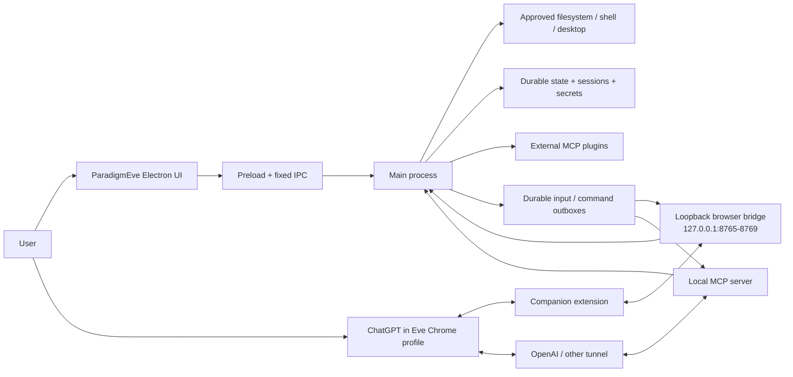

# 01 — System map

Back to [vault index](README.md).

ParadigmEve is an Electron desktop application that makes a ChatGPT conversation able to do durable local work. ChatGPT still owns model execution; ParadigmEve owns local tools, session continuity, browser coordination, persistence and recovery.

## The system in one diagram



There are two intentionally separate network paths:

1. **MCP path** — ChatGPT calls tools through the public tunnel into the local MCP server. This path deliberately does **not** trust a browser origin.
2. **Companion bridge path** — the Chrome extension talks to a loopback-only HTTP bridge using an encrypted pairing token and `chrome-extension://` origin checks. It reports browser observations and picks up browser work.

They converge in the main process, but neither is a substitute for the other. MCP proves a tool request; the Companion proves what exact ChatGPT document/tab is doing.

The browser/local boundary stays one-way in authority. Chrome and the Companion operate browser
state; Electron's main process operates local filesystem paths, permissions and app-owned resources.
Local paths stay in Eve. If a browser feature needs bytes, the main process may snapshot them into a
purpose-specific store and expose an opaque id plus bounded bytes after that exact browser operation
proves ownership. The bridge is never a generic local file-read API. App-owned mirrors such as the
stable Companion folder and the managed Vault Markdown mirror are materialization details, not
ambient Chrome filesystem access.

## The five identities to keep separate

Most of the architecture exists to stop these identities from being conflated:

| Identity | What it means | Durable? | Typical authority |
| --- | --- | ---: | --- |
| **Local session** | The continuous unit of work, recording, project and handoffs. | Yes | `session/store.ts` |
| **ChatGPT conversation** | One provider frontend (`/c/<id>`), replaceable after Compact & Resume. | Lineage retained | Companion + session metadata |
| **Turn** | One exact user-message generation / response episode. | Yes in session history | recorded turn events |
| **MCP request / call** | One tool invocation and its correlated caller evidence. | Recorded | MCP call context + recorder |
| **Worker run incarnation** | One configured-agent-owned worker-garden execution epoch. | Yes | `agents.ts` swarm snapshot |

The durable **session** is the important continuity identity. Compact & Resume changes the provider conversation from A to B without creating a new local session.

## Main-process ownership map

| Concern | Primary owner |
| --- | --- |
| App boot/shutdown, process lifetime, recovery ordering | `src/main/index.ts` |
| Local MCP server + tunnels | `src/main/connection.ts`, `src/main/mcp/server.ts` |
| Model-facing tool execution / caller fencing | `src/main/mcp/kernel.ts` + tool registrars |
| Companion loopback bridge + browser repair | `src/main/bridge.ts` |
| Durable session history | `src/main/session/store.ts`, `recorder.ts` |
| Durable user/internal input outbox | `src/main/session/input.ts` |
| Purpose-bound browser resources | `src/main/browser-resource.ts` + owning feature |
| Compact & Resume transaction | `src/main/session/continuation.ts` |
| Worker broker | `src/main/agents.ts` |
| Pins / Threads / Quilts | `src/main/pins.ts` |
| Pins context selection / fresh-chat injection | `src/shared/pins-context.ts`, `src/main/pins-context.ts` |
| First-class Plans | `src/main/plans.ts` |
| Plugin runtime | `src/main/plugins/manager.ts` |
| ChatGPT connector-schema refresh | `src/main/plugin-refresh.ts` |
| Config / permissions | `src/main/config.ts` |
| Encrypted credentials / pairing | `src/main/secrets.ts` |
| Approved-path sandbox | `src/main/sandbox.ts` |
| Per-chat learned cwd | `src/main/workspace.ts` |
| Expenses template/project binding | `src/main/expenses-project.ts`, `src/main/projects.ts` |
| Expenses canonical structured records | `src/main/expenses-ledger.ts`, `src/shared/expenses.ts` |
| Private local updater | `src/main/update.ts` |

## Renderer architecture

The renderer is intentionally untrusted relative to the main process:

- no Node.js;
- no direct filesystem access;
- no network authority;
- only the fixed `window.api` preload surface;
- main-process IPC handlers validate input with Zod;
- secrets can be set/cleared but never read back into the renderer.

The workspace has four peer destinations:

```text
View / Chat  <---->  Pins  <---->  Plans  <---->  Schedule
      \__________________________________________/
                    same session sidebar
```

All user-facing text goes through one localization layer (`src/renderer/i18n.ts` with the English-keyed
catalogs in `src/renderer/locales/`); the main process only hands it English source text or templates with
the agent's name as `{0}`. See [16 — Languages, localization and aliases](16-languages-localization-and-aliases.md).

Pins, Plans and Schedule are not separate projects. The conversation list remains visible so the user
can move between live chat, harvested knowledge, live work and schedule/routine state without hunting
for which chat owns an item. Schedule remains a first-class durable workspace rather than a Thread
activation; its `#myweek`, `#routines` and `#schedule` shortcuts are context only.

## Important authority patterns

### Durable before side effect

Where a retry could duplicate work, the intended pattern is:

```text
derive exact owner -> persist obligation/claim -> perform external/browser side effect -> record receipt
```

Examples: worker spawn/revival, browser input, restart recovery, chat review heartbeat, plugin refresh click, Compact & Resume send checkpoints.

### Exact identity before mutation

If ParadigmEve cannot prove the exact conversation/session/turn that owns an action, it should refuse or wait. Titles, timestamps, sidebar position and similar text are discovery clues, not authority.

### Browser ACK is not semantic completion

A transport can prove “ChatGPT accepted the message” without proving “the requested work is complete.” This distinction is explicit in the session input outbox, heartbeat receipts and worker lifecycle.

### Projections are rebuildable

Renderer state, in-memory indexes, browser presence TTLs, command offers and derived Plan views are projections. Durable JSON/session records or exact live evidence remain authority.

### Template projects separate intake, evidence, records and interpretation

An inbox-shaped template can reuse one familiar conversation while the linked local project owns the
canonical structured state. Expenses is the current local self-testing example: `data/ledger.json` is the record
authority; chat and the linked `%expenses` Thread provide continuity and useful context. `#quilt`
is broader thematic/context scope and cannot silently choose that project. Raw receipts are optional,
user-controlled evidence rather than the default long-term data model. See the
[Expenses specification](../product/expenses.md) and generic [Feature Spec Template](../product/feature-spec-template.md).

Derived analysis is a different layer from observation. A template may fetch dated external context
only when it helps answer the question at hand; preserve enough source/date/geography/unit/method and
uncertainty to reproduce the comparison, label interpretation separately, and never mutate or rebase
the original project records to fit an index or benchmark.

## Startup sequence at a glance

The primary process roughly does this:

1. acquire single-instance lock;
2. initialize log, config, secrets, session and durable stores;
3. mark this recovery process lifetime;
4. restore config and plugins;
5. restore Goal state, request correlations and blocked chats;
6. wire + restore retired workers / swarm;
7. restore Compact & Resume continuations;
8. install renderer CSP/permission denial and IPC;
9. prepare restart-recovery input if this launch is recovery-authorized;
10. show/focus window and tray;
11. start Companion bridge when required;
12. start session retention and 22-minute review heartbeat;
13. connect MCP/tunnel if configured/forced;
14. run one-shot Companion/browser recovery when installer/update asked for it;
15. start private-local update checks.

See [Runtime, browser and recovery](02-runtime-browser-recovery.md) for the exact recovery implications.

---

> **Implementation contracts.** The sections below moved here unchanged from the former single-file
> `AGENTS.md` map. Their § numbers are kept so references such as “§14” still resolve; the
> [Vault index](README.md#former-agentsmd-sections) lists where each section lives.

## 1. What the whole app is meant to do

For the audience, human needs, Thread/Quilt themes and proactive-support product direction, read
[Product Docs](../product/README.md). Eve should reduce mental load, preserve continuity after
interruptions, and help users protect wellbeing and meaningful goals. The product docs describe
intent; the technical contracts below and current source/evidence govern implementation claims.
The three [22-minute discovery tutorials](../quilt-discovery-tutorials.md) remain the first
Thread/Quilt build's acceptance scope. The broader theme catalog does not silently expand that scope.

ParadigmEve is a Windows/macOS/Linux Electron workspace around ChatGPT. The user can work
from the desktop app while ChatGPT generates answers in its own browser conversation. The app
sends instructions, records the conversation, supplies local tools over MCP, and coordinates
long-running work. The companion extension connects that browser conversation to the local
session. ChatGPT still owns model execution and its native account/model availability.

The product should feel like one continuous workspace: choose a project, send a task, watch
real progress, correct it while it runs, inspect what actually happened, and continue without
losing the project, history, workers or queued instructions when a chat grows too long.

### The user's normal path

1. **Set up access.** Approve folders and capabilities, configure a tunnel, connect Core in
   ChatGPT, and load/pair the companion extension. Desktop and Plugins are optional connectors.
   Connection, browser pairing and account model availability have separate status.
2. **Choose where work belongs.** Add a local project folder or use an unfiled chat. A project
   gives the session its working folder and root `AGENTS.md`; permission still comes from the
   approved roots. Removing a project grouping keeps its chats and folder association.
3. **Write a message.** Select an account-observed model and reasoning level, optionally attach
   files, choose ordinary/Goal/Loop behavior, and Send. A fresh chat with no selected/observed
   model can keep ChatGPT's native default without waiting for the account catalog. The app freezes an input in its durable
   outbox before delivery. “Queued”, “put into the composer” and “ChatGPT accepted it” are
   different facts and should be presented that way.
4. **Work and steer.** The timeline combines native user/assistant messages with exact local
   tool results. An immediate correction can join an eligible tool response. An after-turn
   message waits for a verified completion. Native file uploads always use the browser send
   path. The queue remains editable until its exact entry has been claimed.
5. **Plan or automate deliberately.** A generated workflow gives the executor the whole job
   immediately and queues later verification checkpoints. Goal continues unfinished requested
   work and may stop. Loop keeps asking for deeper work within the same brief until switched
   off. Astra uses its finish-tool boundary for automatic continuation.
6. **Continue across time and surfaces.** Workers sleep for reuse. Compact & Resume moves the same
   local session from old ChatGPT chat A to new chat B. History remains readable; queued work and
   project identity remain attached to the session. Ordinary ChatGPT conversations are not local
   project silos: a 22-minute semantic review heartbeat sends a scoped, read-only worker to
   inspect locally recorded user work and unfinished durable Plans. It does **not** inspect
   ChatGPT browser history or infer missing cross-device conversations. Its verified findings
   go to Prime for a separate decision; the reviewer cannot execute or delegate user work.
   Newer instructions, active work, ambiguous ownership and completed results win.

### Feature vocabulary — keep these distinctions

| Concept | Meaning and intended effect |
| --- | --- |
| Local session | Durable identity for the work, its history, project and current ChatGPT binding. |
| ChatGPT conversation | Replaceable provider frontend; its id is not the durable session id. |
| Turn | One authored user-message generation and its exact response/work. Interim prose is not a final boundary. |
| Approved root | Filesystem access the user granted; may be a parent containing several projects. |
| Local project | Explicit folder association and sidebar grouping; grants no new permission. |
| Native ChatGPT project | Provider `/g/g-p-…/c/...` context. A local project may be explicitly linked to exactly one (`LocalProject.nativeProjectId`, unique, never matched by name): chats observed inside it join an unbound session to that project, and fresh chats enter it through a known chat's native Project link (`nativeEntryConversationId`) or fail visibly. |
| Pin | The user-facing save action; each Pin saves one useful item into exactly one Thread. Internal persisted Pin fields keep their existing schema names. |
| Quilt / `#quilt` | User-facing wider thematic/context grouping of Threads. `#` is the Quilt sigil: for example `#Eve`. A Quilt can group multiple Threads, and a Thread may belong to multiple Quilts, so the concept can be explained informally as “tagging” when that helps a user, but **Tag is not the operational product name or syntax**. Internally this is still stored in the existing Collection/`collectionId` structures for compatibility. A Quilt owns an optional short durable description and can expand member Threads' saved Pins for fresh-chat context, but never activates member Thread descriptions or prompts; it does not select a project or own canonical project data. When a referenced Quilt has no description, Eve may offer to fill one from related durable chats or web sources, but must not write it until the user chooses. |
| Thread / `%thread` | User-facing specific durable work/context fabric and mandatory Pin home. Each Thread owns an editable durable description plus an optional first-class prompt. Activation by an exact `%name` reference or explicit Start chat contributes description, then prompt, then saved Pins. This is distinct from a Prompt Pin, which is an authored user message saved as one context item. Type follows content: one or more Pins makes a **Thread**; zero Pins plus a prompt is an **Instruction** (in the `%instructions` category); zero Pins and no prompt is a **Concept**. Link and description are orthogonal. If no same-name wider Quilt exists, `#name` may resolve to that exact Concept backing Thread and load any description with prompt semantics suppressed. Internally the Thread is still stored in the legacy Quilt/`quiltId`/`contextQuiltId` structures for compatibility. An explicit Thread may bind a template project, but the Thread is not a duplicate database for that project's canonical records. |
| Skill | Reusable procedure selected by relevance from compact metadata. It is not a slash command, Thread, Pin, Quilt or plugin. Full `SKILL.md` and support files stay lazy until one Skill clearly matches the authored request. Imported/external Skills are readable but not rewritten; Eve-owned Skills may be revised/versioned. Current user instructions and explicit Thread prompts outrank Skill procedure. |
| Local transcription / diarization | App-owned local audio pipeline: optional mic + system-audio capture, Whisper transcription on truthful CPU/GPU execution, local speaker diarization, and transcript artifacts with backend/model/privacy provenance. Separate source tracks remain evidence; a mixed track is not automatically the canonical truth. |
| Goal objective | The requested finish line for one chat. It persists independently of a provider attempt. |
| Goal / Loop | Mutually exclusive modes of one driver. Goal can decide no further message is needed; Loop continues within scope. |
| Generated workflow / checkpoints | User instructions owned by the outbox; delivered at real finish/completion boundaries. |
| Chat review heartbeat | A durable 22-minute review obligation assigned to a bounded worker for exact local sessions and selected Plans. The worker may report a finding to Prime, not execute user work, infer unrecorded history, or seize source-chat authority. |
| `update_plan` | The agent's displayed progress plan. It does not execute or consume queue entries. |
| `session_finish` | Astra's explicit near-finish hold/notice boundary; does not mean the whole task is already verified. |
| Prime / worker | One owning conversation and its reusable subordinate chats. Several prime families may run independently. |
| Decision helper / planner | A role-specific chat that produces a continuation decision or workflow; it must not execute the reference task. |
| Code-mode `exec` | Bounded JavaScript composition of one MCP surface's tools. `exec_command` runs an OS process. |
| Stop / End turn / Block | Stop requests native generation cancellation; End turn releases a finish hold; Block revokes exact-chat local tool access. |

### Product-wide invariants

- One meaningful fact has one owner. Other modules may project it, never independently decide it.
- User corrections extend the original task. Plans and automation must not quietly narrow it to
  whatever the last assistant answer happened to describe.
- A reminder/routine that depends on the conversation that created it must carry a compact
  continuation capsule: the user's still-relevant intent, recent decisions/observations that may
  not live in canonical storage, presentation/output expectations, and references needed to recover
  source context. At execution, treat that capsule as rehearsal/context, not frozen truth: re-read
  canonical/live authorities and current information where the task requires them. A fresh
  schedule-owned chat must not improvise from the bare reminder text when its meaning depended on
  the originating conversation.
- Visible progress is truthful: no invented completion, lost attachment disguised as a file
  reference, sent claim based on insertion, or success based on a button click alone.
- Browser use is economical. Reuse an eligible document; one operation owns one elected tab
  across navigation and MV3 suspension. Startup, a wake socket and a maintenance alarm are not
  independent permission to open a tab. Missing receipts and user-closed elected tabs do not
  create another opening attempt. Transfer opening authority when it is handed out.
- Waiting chats and sleeping workers retain their durable history and identity, not an
  indefinite browser tab. Settled app-owned pages become eligible for New Chat reuse after
  two minutes without work and automatic closure after five. Fresh document/draft/generation
  checks remain mandatory; selected Chrome tabs veto idle closure, and pins veto closure and
  New Chat reuse. Terminal, blocked, cancelled, superseded and duplicate cleanup retains its
  separate authority. Unknown/personal ownership, live work and pending delivery are not idle.
- Unknown identity fails closed where a wrong choice could mutate, attribute or message the
  wrong owner. Presentation can degrade visibly; execution must not guess.
- Every async result proves its original owner and epoch still apply. A → B → A navigation
  defeats a check of the selected id alone.
- Bound compressed bytes, decoded pixels, base64, text, structured results and queue growth at
  their respective owners. A small rendered preview is not a memory bound.

## 2. Runtime model and identities

There are four cooperating planes. Core, Desktop and Plugins are three logical MCP surfaces on
the local MCP listener; the browser bridge is a separate loopback service with separate auth.

```text
ChatGPT model                         ChatGPT browser page
  | MCP via public tunnel               | native UI and conversation state
  v                                     | MAIN: fiber.js + usage.js
Core / Desktop / Plugins                | isolated: chatgpt-dom.js + content.js
  | secret path per surface             v
server -> registrar -> kernel       background.js (suspending MV3 worker)
  | live permission + caller proof      | journal, tabs, claims, ACKs
  v                                     | paired HTTP + wake-only socket
local files / processes / desktop       v
or external plugin manager           bridge.ts
  |                                     |
  +--------- recorder / sessions / input / continuation / agents / Goal
                                        |
                                ipc.ts -> fixed preload API
                                        |
                                Electron renderer workspace
```

The extension observes ChatGPT and performs authorized browser orchestration. It never executes
the model's local tool. The main process is authoritative about what a local tool actually did.
The renderer has no direct filesystem, command, secret or generic main-process authority.

Keep the browser/local boundary asymmetric. Chrome and the Companion own browser state; Electron's
main process owns local filesystem paths, permissions and resource materialization. Native paths
stay inside Eve and must never cross the renderer or browser protocol as a generic file API. A
browser feature that needs local bytes may use a purpose-bound main-process resource store such as
`browser-resource.ts`: Electron snapshots/materializes the bytes, exposes only an opaque id/size,
and serves bounded chunks only after that feature proves the exact operation/document owner. Do not
add generic bridge file-read/list/open routes. Selective app-owned mirrors such as
`userData/extension` and `userData/docs/vault` remain main-process-owned materialization; their
existence does not grant Chrome ambient filesystem authority.

### Identify the boundary before debugging

| Boundary | Identity that must survive |
| --- | --- |
| Filesystem | Approved root plus canonical real path, regardless of native/virtual spelling. |
| MCP ingress | Normalized HTTP request id. |
| Tool attribution | Request id → exact conversation id → local session epoch. |
| Browser observation/action | Conversation + Chrome document id + navigation epoch + message/turn id. |
| Session continuation | Local session id + continuation token + A/B lineage + send checkpoints. |
| Input | Outbox UUID + local session + elected browser owner or exact tool recipient. |
| Agent routing | Exact prime family/run incarnation + worker conversation; `worker-1` alone is ambiguous. |
| Workspace | Proven session/project or caller/agent key + cwd. |
| Terminal | Durable local session principal → process session id. |
| Renderer | Selected session/draft key + load generation. |
| Connection | Endpoint/tunnel generation. |
| Desktop input | Capture frame/accessibility ref + target geometry + helper generation. |

When four features break together, follow one concrete identity through these boundaries. Find
the first wrong fact, not the last UI that displayed it. Discovery vs enforcement, page vs
service-worker lifetime, and local session vs frontend id are recurring sources of mistakes.

### Lifetimes are part of the design

| Storage/lifetime | What survives | What it cannot prove |
| --- | --- | --- |
| App `sessions/` and named `state/` files | App restart; committed history and control intent. | That an old page is currently running. |
| Extension `storage.local` | Browser restart; pairing/disconnect intent, deferred revival metadata, command ACK custody. | A surviving tab/document or current account entitlement. |
| Extension `storage.session` | MV3 worker suspension; journal, tab/document registry, elections and live policy ownership. | A whole browser restart. |
| Content/Fiber memory | One document and its navigation epochs. | Anything after reload unless re-observed or restored from its actual owner. |
| Process manager | Running app's live/unread process sessions. | Process survival across a full app restart. |
| UI/local preferences | Drafts, expansion, theme/language/width as implemented. | Send receipts, task completion or tool permission. |

`durable.ts` provides queued temp-file→rename publication, not a database-grade power-loss/fsync
guarantee. `writeDurableNow()` is the required barrier before an acknowledged control transition
or browser side effect. Per-file queues allow independent writes; cross-file semantic ordering
must be explicit in the caller. Missing/corrupt auxiliary state logs and reads as null so the app
can start; restore may only reconstruct facts from independent durable proof.

## 18. Renderer and IPC

`renderer/main.ts` owns the shell/setup/settings and the peer Chat/Pins/Plans destinations;
`chat.ts` owns sessions, composer and timeline. Projects, workers, Pins/Threads/Quilts, app Plans, model
choice, usage and plugins have focused modules (§4). The renderer
calls a fixed `preload/index.ts` allowlist into validated `ipc.ts`/`plugins-ipc.ts` handlers.
No arbitrary IPC invocation, Node access, filesystem path opening or renderer-side secret store.
Pushes and async loads are scoped to selection/draft generation; a late load must not overwrite
focused edits or a newer A → B → A view.

The sidebar groups local projects/sessions, exposes worker state and retains deliberate width
and expansion preferences. The chat keeps the current input queue/plan visible alongside a
paged transcript. Main owns durable mutation acknowledgements; renderer optimism is not a
receipt. Native edit context menus respect the focused editable control and selection.

Session metadata owns `titleSource` (authored fallback, provider, app-owned, manual). App-owned
titles are durable product naming decisions and do not yield to later provider-generated titles;
manual user renames still outrank them. The preview uses only
the first authored user message, at one 80-character bound; injected instructions/AGENTS frames
never become preview text. `session/title.ts` supplies presentation and legacy recognition;
store serialization protects manual/origin names and current-conversation title observations.
Apply provider titles after the batch's messages, so a late receipt or title-first batch cannot
strand a preview. Cold reads repair legacy context previews from canonical authored history.

Captured ChatGPT HTML passes a strict allowlist; authored plain text stays text. Provider
citation ranges use Unicode code points and map to UTF-16 before slicing. Exact uploaded-file
names render as plain chips; unresolved file citations do not gain invented local links.
Tool result rendering preserves structured text/image/resource distinctions within bounds.
App-owned external/local links cross their validated main-process route.

US English and Swedish are the explicit UI languages (`i18n.ts`, `locales/sv-SE.json`), with
the selected locale in `cos.ui.language`. Setup and Settings use a single current-language flag
and dropdown rather than permanently showing every locale. Changing language repaints owned labels
while retaining drafts/selections; never translate authored messages, provider text or file paths.
Authored prose uses automatic text direction; shell/code remain LTR with logical layout edges.
Theme and layout preferences do not change backend authority.

`renderer/plugin-refresh-reminder.ts` owns the chat-header reminder to refresh plugins
in ChatGPT. Its X stores only the acknowledged running `state.update.current` version in
`cos.plugins.refreshReminder.dismissedVersion`; downloading a newer version does not rearm
it. No acknowledgement shows the reminder, including the first version with this feature.
It survives restart until dismissed, returns for a different running version and is hidden
in Settings. It stacks with update/extension notices and never marks an actual connector
refresh complete or starts a browser action.
