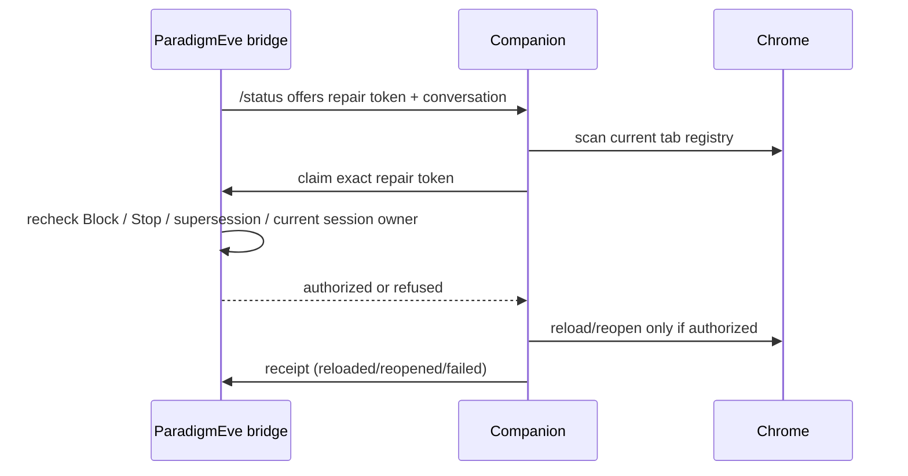

# 02 — Runtime, browser and recovery

Back to [vault index](README.md).

This subsystem is where “the app is running” is deliberately separated from “Chrome exists”, “the Companion is paired”, “a current ChatGPT document checked in”, and “this exact chat may be reloaded.”

The GitHub **v2.4.0** source tag and the earlier locally installed
Windows x64 debug build have different provenance. Source contracts and
installed self-testing from one build do not prove another installation runs
the same bytes; verify its Companion build and recovery readiness before
claiming installed behavior.

## Process lifetime

`src/main/index.ts` owns the Electron lifetime.

- Only the process holding Electron's single-instance lock may initialize shared state.
- A second process can signal one-shot flags such as `--connect-on-start` or `--recover-companion-browser` to the primary.
- Shutdown is terminal: startup continuations are fenced so they cannot recreate a window or reconnect after quit has begun.
- Clean shutdown flushes durable work before recovery crash evidence is cleared.

## Dedicated Eve Browser

ParadigmEve uses a dedicated Chrome profile under its user-data area. This is the app-owned ChatGPT/Companion surface, distinct from the user's ordinary Chrome profile.

Why it exists:

- pairing and cookies are stable for Eve;
- browser recovery can target an exact native window identity;
- setup/provider pages do not accidentally open in another signed-in profile;
- app-owned recovery does not need a debugging port or Playwright attachment.

`src/main/setup-assistant.ts` owns profile launching and the setup/recovery browser helpers.

Eve-owned web navigation, renderer Open link, saved Thread web destinations, plugin OAuth
sign-in and the local static Archive open in this **same dedicated profile**, never via the
OS-default personal browser. `src/main/eve-browser-links.ts` centralizes web/verified local
browser-file opening; it does not fall back to `shell.openExternal` if the Eve Browser fails.
Users choose which accounts to sign into within Eve Browser. Access to a personal browser,
its existing tabs/cookies/accounts/passwords, or cross-profile credential import is **not**
implicit consent from installing Eve or enabling general Computer Use. `mailto:` and explicitly
allowlisted native Settings deep links are separate OS handler actions, not web navigation.

## Companion bridge

`src/main/bridge.ts` hosts a separate local HTTP server on `127.0.0.1`, normally one of ports **8765–8769**.

Security properties:

- only loopback;
- protected routes require a bearer token stored via `secrets.ts`;
- browser requests must come from a `chrome-extension://` origin;
- request bodies and request rate are bounded;
- the bridge transports observations and browser commands, not arbitrary filesystem/process access.

Pairing state and live presence are different facts:

- **paired** = an encrypted bridge token exists and has not been explicitly revoked;
- **present** = this app process has heard authenticated Companion traffic recently;
- **chatTabOpen** = the Companion's recent exact Chrome tab census says at least one ChatGPT tab exists;
- **recovery ready** = a current-version ChatGPT document registered with this app process and authenticated presence is fresh.

Persisted pairing from yesterday cannot satisfy post-install recovery readiness by itself.

## Browser repair authority

The checked 2.4.0 source uses **bridge protocol 15**. That protocol number establishes an
app/Companion handshake contract; the source version alone cannot prove which bytes are installed
or which Companion generation Chrome is actually running.
Model discovery excludes command-marked handover and worker tabs. The page also refuses discovery
while it has a command marker, active command attempt or command journal gate, so opening the model
picker cannot replace the composer owned by that command. Background-window reconciliation leaves
pinned tabs in the user's chosen window.

If App Stop targets an exact turn still open locally after ChatGPT is idle and has no native Stop
control, the Companion records that turn as user-stopped and closes it through the observation path.
It does not require a native button that no longer exists.

Browser repair includes a final
`/browser-repair/claim` fence immediately before Chrome mutation. The flow is:



This closes the race where a repair could be valid when `/status` was read but invalid by the time the extension finished scanning tabs.

## Browser recovery is evidence-driven

Repairs can be queued for distinct reasons such as silence, assistant error, missing attribution,
compaction pickup, Goal pickup or worker/owner identity recovery. They share one per-conversation
repair owner so two watchdogs do not independently reload the same chat.

Important rules:

- A blocked or superseded chat loses repair authority.
- A Stop can revoke a queued repair before mutation.
- Silence is measured from durable activity evidence, not from browser visibility.
- A browser lifecycle event does not erase the semantic fact that a turn is still owed.
- A confirmed repair gets a cooldown / observation window; repeated reloads are bounded.
- Browser attention may be required for throttled background work, but changing the foreground tab
  needs its own current focus, page and human-interaction checks.

- An **unattributed-activity** repair first asks the page whether ChatGPT is streaming
  (`clf-page-status` → `streaming`). A streaming page is alive: the repair stands down, reports the handout
  as not done, and the next pass decides. Reloading mid-stream ends the reply ("Resume stream
  unavailable" / "could not be loaded"). Silence and assistant-error recovery still reload, because they
  exist for pages that look busy and are not.

Known broad silence windows in current code: ordinary work uses the standard two-minute silence concept; known Pro work gets a longer window. Exact constants and special Goal/compaction schedules live in `bridge.ts` and should be read before changing recovery timing.

### Protect an actively used ChatGPT page

`extension/background.js` separates tab ownership from the permission to focus, relocate, reload
or reuse a tab. A pinned tab, pending navigation, active human draft, typing/voice state or changed
document is not an expendable recovery target. Foreground-window tab switches can steal keyboard
focus even without raising a Windows window, so the Companion checks both the actual window focus
and whether the exact target is already active. Background-window maintenance has its own proof.

App-owned command pages carry explicit markers, and browser repair rechecks the exact request at
the last claim before acting. If the current tab or composer no longer matches, leave it alone;
do not open a second copy of an active conversation or resend an uncertain message. See
[session delivery and continuation](04-sessions-outbox-and-continuation.md) for send ownership.

## Page evidence on ChatGPT's current renderer and stream

ChatGPT is not an API; these shapes were measured live (2026-09-26) and are read only by the
Companion's page files. When ChatGPT changes them, probe the live page before changing code.

### Assistant replies (`extension/fiber.js`)

The page renders one `[data-turn-key]` element per exchange. React no longer passes message objects
(`id` + `author.role` + `content.parts`) through props. Each reply unit renders a **render item**,
`props.item = { type: 'assistant-message', messageId, latestMessageId, sourceMessageIds, content,
phase, completed, turnExchangeId }`, and a context provider below it carries `props.value =
{ messageId, isStreaming, conversationId, turnId }`.

`exchangeMessagesOf` still prefers real message objects when a page provides them, then adapts render
items (`renderItemMessage`) into the same model shape so all downstream identity/finality rules apply:

- identity is the provider `messageId`, and `latestMessageId` plus every `sourceMessageIds` entry must
  agree with it; an item built from several messages is not guessed at;
- a context naming another conversation, an unknown `phase`, or empty `content` drops the item;
- the reply is final only when `phase: 'final_answer'`, `completed: true` **and** its context says
  `isStreaming: false`; anything less is recorded as streaming;
- a final that was already settled before the current generation began cannot close a later turn if
  ChatGPT briefly remounts that previous answer around Send; turn ownership also checks whether the
  assistant section belongs below the current user question before accepting it as this turn's final;
- rendered HTML is joined by the exact `data-chatgpt-selection-message-id` holder, never by text.

Render items carry no creation time. A reply backfilled from an older exchange is therefore timed when
it is recorded, not when ChatGPT wrote it.

### Tool-call attribution (`extension/usage.js` → `content.js` → bridge)

A connector call reaches the app with ChatGPT's request id, which is one id for the whole assistant
turn. The page learns that id from the `/backend-api/f/conversation` event stream:

1. the response opens with an event naming `conversation_id`; the following `input_message` event
   carries `input_message.metadata.request_id` with no conversation. `usage.js` joins them **within
   one response only**; an event naming a second conversation retires the join;
2. `content.js` parks an id that arrives before its chat has a `/c/` route, and keeps it across the
   move into exactly the chat it names;
3. the page posts the sighting to `/correlations`. ChatGPT announces the id when the turn starts,
   usually before the first tool call, so the app often answers `pending`. The bridge keeps pending
   sightings (bounded count, 15 minutes) and completes the join the moment local MCP admits a call
   carrying that exact id (`onInboundToolRequest` → `completeEarlySighting`). Admission is still
   required and an existing correlation is never overwritten;
4. the page also remembers its sightings (bounded, 15 minutes). When the app asks it to reconnect
   recorder evidence (`clf-recorder-reconnect`), it re-offers them. This recovers a turn that spans an
   app restart, since the restarted app never received the turn's one-time announcement.

A healthy call logs `bridge: request <id> attributed to <conversation> from its earlier stream
sighting` and has a small `identity_ms`; a missing join waits `identity_ms=20000` and is filed under
Unattributed activity.

Known limit: `usage.js` runs only when a ChatGPT document loads, and a Companion reload re-injects
`chatgpt-dom.js`, `fiber.js` and `content.js` but not `usage.js`. A tab that stays open across an
update keeps the previous stream reader until that tab is next reloaded while idle.

## Restart recovery

`src/main/session/recovery-memory.ts` implements the app restart contract.

Recovery is authorized only by one of these conditions:

- previous app lifetime was unclean;
- background/login recovery launch;
- explicit Companion recovery launch;
- update/reinstall launch.

An ordinary foreground open is not enough.

The app finds a recovery candidate narrowly: an ordinary current conversation with an open durable turn that has **exact request-id-attributed local tool work after that turn began**. It will not choose “the latest-looking chat.”

Before touching the browser it enqueues a deterministic durable recovery input for the exact session/conversation/turn. The id is derived from those identities, making repeated restarts idempotent.

That wake is bound to the open turn it recovers and retires as "the conversation moved on" as soon as a
newer turn boundary appears. App-internal automation must therefore let it land first: automatic
Compact & Resume is not filed for a session that still owes its restart wake (`restartRecoveryPending`),
because posting the app's own handoff would open that newer turn itself. A user message still moves the
conversation on and retires the wake.

That ordering applies before a new automatic handover starts. If Compact & Resume is already replacing
the source conversation, the old chat is fenced from receiving new queued input. The restart wake stays
durable and follows the same session to the successor after the continuation commits, instead of being
typed into the chat that is being replaced.

`RECOVERY.md` in userData is informational policy for the agent. It is not delivery authority; the durable outbox is.

## Companion refresh during reinstall/update recovery

Replacing the packaged extension files is not enough when the dedicated Chrome profile is already
running: that profile can still have the previous MV3 generation loaded. Reinstall/update recovery
therefore materializes the current Companion into ParadigmEve's stable unpacked-extension folder and
then refreshes the dedicated profile through Chrome's own restart/session restore path.

- If the dedicated profile is already open, ParadigmEve restarts that exact profile through
  `chrome://restart/`, allowing Chrome to reload the current Companion and restore its durable session.
- If the profile is closed, ParadigmEve launches it with **restore last session**; no extra restart is
  needed.
- If Chrome presents **Restore pages?** after an unclean browser/system shutdown, recovery invokes the
  native **Restore** action before opening replacement tabs.
- Restored human tabs are preserved. Exact Eve/worker conversations are reused only when their identity
  is proven.
- `chrome://extensions/` is setup/maintenance, not an automatic recovery destination.

### Companion build identity

Every debug build of one version reports the same `version` and bridge protocol, and Chrome keeps
running the unpacked code it loaded until the extension reloads. Two rules keep the running Companion
equal to the installed one:

- **Materialize before any browser launch.** At startup the app refreshes the stable Companion folder
  before the bridge answers `/hello` and before any restore/recovery path opens the Companion profile.
- **Name the build.** Each materialized manifest is stamped with `version_name = "<version> build
  <12-hex fingerprint>"`, and `/hello` and `/status` report that `companionBuild`. A Companion whose
  *loaded* manifest names a different build calls `chrome.runtime.reload()` once per named build (never
  a loop), but only from a maintenance pass in which `/status` says `companionBusy: false` (no tool call
  or MCP request running), no bridge command is in flight, and every ChatGPT page answers
  `clf-recorder-ping` with `busy: false`; a page that answers without `busy` runs older code and counts as
  busy. `runtime.onInstalled` then re-injects the current page code into already-open ChatGPT tabs.
  Unstamped development folders are never second-guessed. Companions up to 2.2.9 still reload as soon as
  `/hello` names another build, which is why `/hello` keeps the field (ported from chat-on-steroids 2.1.17).

## 22-minute semantic review heartbeat

`src/main/chat-review-heartbeat.ts` persists a review of **locally recorded requests that may
have received an answer without the requested action**, plus old Live Plans that still need a
source-backed status review. This is separate from the authenticated socket's transport wake.
The current 2.4.0 lane dispatches an **app-owned, read/review-only worker** through
`src/main/agents.ts`, tied to the exact proven ordinary Prime session/conversation and the
epoch's opaque debt key. It does not type the review into Prime's composer.

Each due epoch has two bounded obligations:

- Review recent **locally recorded sessions** between the exact debt `sinceAt` and `untilAt`.
  **Do not inspect ChatGPT browser history or use Computer Use to discover other conversations.**
  Unrecorded phone/cross-device chats are unknown, outside this pass and not grounds to guess.
- Review up to **four** selected Live Plans, following each exact Plan id, revision and source
  session before classifying it. A truncated checklist label is display-only; the Plan's durable
  provenance and ids are retained.

The worker may read local/session evidence, record its **own** `update_plan` checklist in Eve
activity, acknowledge each selected Plan with direct `chat_review_plan`, send a bounded finding
to Prime, and finish. `src/main/mcp/kernel.ts` blocks ordinary mutation, execution, delegation,
file editing, installation and browser driving in this lane. It cannot change a user's Plan
checklist or archive it. `chat_review_plan` reports `ready-to-archive`, `tbd`, `blocked`,
`superseded` or `awaiting-user`, with exact revision/source revalidation. **Prime decides**
whether a reported unfinished request should actually be executed.

Only an accepted direct `chat_review_complete` call bearing this worker's exact key, lineage,
classification and required per-Plan acknowledgements retires the epoch. A browser ACK, final
model prose or worker finish is not that receipt. New debts use `reviewLane=worker`; legacy
Prime receipts cannot complete them. Partial acknowledgements and the bounded Plan batch survive
restart and exact Compact & Resume rebind. Broker retries are fenced by worker/key/Prime identity;
a silent worker can be put to sleep for a real revival, and repeated no-receipt wakes are bounded.

An accepted finding destined for Prime is tracked independently from the review clock. If the
finding's browser Send was authorized but its delivery is ambiguous, the durable
`uncertainFindings` trail retains that uncertainty rather than replaying the send or freezing
every later heartbeat. A later verified finding reaches Prime through the normal outbox. This
is a **review and handoff mechanism**, not proof that every due heartbeat acted or that any
unrecorded user request was discovered.

See the detailed design in [`docs/chat-review-heartbeat-implementation.md`](../chat-review-heartbeat-implementation.md).

## Reinstall controller contract

`scripts/windows-self-reinstall.ps1` is deliberately external to the app process. **Do not pre-close Eve or Chrome for a normal upgrade.** The controller starts the assisted installer and lets the installer request that the running Eve instance close. That is the path designed to survive app shutdown and continue driving the install.

After install, the controller starts/signals Eve with:

```text
--connect-on-start --recover-companion-browser
```

This is intentionally a foreground recovery launch. It uses the normal initial-window path so Eve is visible after the upgrade instead of leaving the recovered app tray-only.

Chrome's durable session is authoritative for restart recovery. An already-open dedicated profile is
restarted through `chrome://restart/`; a closed profile is launched with Chromium's **restore last
session** request. If Chrome reports **Restore pages? Chrome didn't shut down correctly.**, Eve invokes
native **Restore** before considering replacement tabs. The restored session can include the human's
ordinary tabs as well as Eve/worker ChatGPT tabs, so recovery preserves the whole session and lets
exact-conversation discovery reuse those restored documents instead of synthesizing replacements.

### Current readiness fence

`windows-self-reinstall.ps1::Test-RecoveryReady` requires a current `/recovery` document with
product `paradigmeve`, bridge `15`, and `ready=true`. A successful installer exit or an Electron
process alone is not recovery readiness; a current-generation Companion ChatGPT document must have
checked in to this app process.

---

> **Implementation contracts.** The sections below moved here unchanged from the former single-file
> `AGENTS.md` map. Their § numbers are kept so references such as “§14” still resolve; the
> [Vault index](README.md#former-agentsmd-sections) lists where each section lives.

## 5. Startup, configuration and shutdown

**Intent:** open a usable local workspace, restore accepted work consistently, and exit without
leaving an invisible process, tool, writer or installer competing with the next launch.

The single-instance lock must be won before touching shared userData. The losing process marks
itself quitting immediately; `app.quit()` alone does not stop module evaluation. Activation from
second-instance/tray/Dock is gated until restore, CSP, permissions and IPC are ready. Once quit
begins, no delayed startup callback may re-enable window creation.

Startup initializes config/secrets/session/durable paths, restores the saved model catalog and
plugin manager, loads Goal ledgers, exact correlations and blocked chats, then retired workers
and every active/dormant prime family. Persistence hooks exist even when multi-agent is Off.
Continuation restore follows swarm restore because it may repair prime ownership. IPC/input
hooks precede browser traffic. Then the secure window/tray, bridge for recording or agents,
independent retention maintenance, the 22-minute semantic chat-review maintenance owner, optional
connector auto-connect and updater lifetime begin. Chat review uses the existing durable browser
outbox and has an explicit shutdown stop hook; it is not another browser-opening authority.
The current first-window model-discovery exception is noted in §21.

The composer preference is the independent `ui.chatModel`/`ui.chatReasoning` pair, saved through
`chatModels:preference`. Restore it before model discovery completes; worker/helper defaults are
never migration evidence for that pair. Explicit native default is null/null. Existing sessions
use their own model observations unless the current account surface proves Free/Go native-default.
On that surface Eve exposes only **ChatGPT Default**, hides the thinking-effort slider, and sends
null/null; it must not surface a Free-account Think toggle or reuse an older paid selection.

Settings use validated current config and `effectiveCapabilities()`. Fresh-install defaults,
legacy omitted fields and malformed-file recovery are three different cases. User choices must
not be widened because a newer version added a field. Read-only derives from the write-capability
set; adding a new mutating capability must make it read-only-blocked automatically.

Renderer settings save `{base, patch}`. Main performs a field-wise three-way merge so an unchanged
form field cannot undo a newer browser-side setting. Renderer saves also serialize snapshots
from the latest requested state, preserving fast successive edits. Disable side effects are
ordered: revoke/park worker execution and durably retain history, cancel its commands while the
bridge is available, then stop unnecessary bridge/publication resources.

The BrowserWindow keeps context isolation, sandbox and web security on; Node integration and
webviews off. CSP, permission denial, navigation/window restrictions and fixed preload methods
remain intact. OS consent for Desktop is independent from the app's settings.

`durable.ts` serializes per filename, atomically replaces JSON and retries failed generations;
lazy snapshots materialize at the write boundary. Independent files may flush concurrently.
Cross-file semantic transactions require the owner's explicit awaits, not a global disk queue.

Shutdown owns an ordered, bounded sequence: stop admission and drain accepted HTTP work; stop
process/native/plugin/tunnel resources; flush recorder work; flush sessions and named state;
flush operational logs; hand off an eligible verified update; finally `app.exit(0)`. Every
long-lived timer, process, socket, subscription and writer needs a shutdown owner. Per-task
timeouts do not replace a bound on the whole teardown. Ordinary reconnect/disconnect must not
drop an accepted mutation just to finish quickly; final shutdown has its explicit drain budget.

## 13. Extension, account models and browser preferences

**Intent:** make native ChatGPT observable and controllable for an exact authorized operation,
while leaving ChatGPT's messages, model execution and account permissions with the provider.

| Component | Responsibility |
| --- | --- |
| `chatgpt-dom.js` | All provider selectors and DOM-shape assumptions, composer/upload/model/turn primitives. |
| `fiber.js` | Bounded MAIN-world React evidence: messages, request ids, generation/model state and installed connector declarations. |
| `usage.js` | Bounded account-usage and exact live stream request-origin observation. |
| `content.js` | Isolated-world recording, exact turn/navigation ownership, input/command execution, native-page companion UI. |
| `background.js` | MV3 journal and HTTP transport, tab/document registry, command elections and durable ACK custody. |
| `popup.*`, `overlay.css` | Pair/reconnect status and extension-owned presentation; no local tool authority. |

Content↔MAIN messages need the expected source, type, nonce and navigation epoch. MAIN evidence
is untrusted data, not instructions or filesystem permission. Prefer bounded observations of
the current document over repeated full Fiber/DOM scans. Shared selectors belong in the DOM
adapter; do not make each feature guess a different composer or terminal message.

The service worker journals observations before acknowledgement, batches/replays them after
suspension, and preserves event identity so retransmission does not create duplicate turns or
messages. Two transport slots, one batch per conversation and fair batch election prevent one
hot/stalled chat blocking another. Command ACK custody precedes later observations from that
route. Reconnection restores eligible documents before creating new work; browser restart is
a different lifetime from MV3 suspension (§2).

An idle composer or missing Stop button alone does not prove a completed answer. Turn state
combines native message/terminal evidence with exact user/assistant identities and live tools.
Interim prose, tool progress, refusal/error presentation, interrupted generation and final
completion remain distinct. Navigation first retires the old epoch; no late callback may record
or send for it. A settings overlay must not count as a usable hidden composer.
An exact terminal Fiber descriptor on the latest assistant turn also vetoes recovery of an
unrecorded generation from a persistent Stop control. An older terminal before a newer user
question grants no such veto; a presentation artifact must not mint another active turn.

Native Send/Stop controls belong to the current composer's form and must be rendered outside
transcript/extension surfaces. Hidden, inert or quoted controls grant no action; multiple Send
buttons are ambiguous. The existing transcript observer also follows composer-side relabel/hide
mutations so hidden tabs notice Stop transitions without waiting for a throttled timer.
Submission observes native Send readiness and acceptance within one 30-second deadline, freezes
the editor/text/document, and clicks once. It never substitutes synthetic Enter. Goal-token and
desktop-input authorization run when Send becomes ready, followed by a fresh local owner check.
Goal preparation/rollback reuses the existing exact composer draft lease; identical text in a
replacement editor or a user's intervening edit never grants cleanup authority.

### Account-evaluated model selection

`chat-models.ts` owns the app catalog and selection validation. The existing MAIN bridge reads
bounded account-evaluated metadata, then the native picker confirms the actual model/effort for
Send. A visible option, an English label, a remembered release name or “Upgrade required” is not
entitlement. Do not enumerate every model × effort or create helper tabs to compensate for an
uncertain catalog. Exact family rules live in `shared/chat-models.ts`.

Direct Chrome selection is observed even with the picker closed. The existing MAIN scan joins
the current composer's exact model identity to the native trigger's visible effort, then stamps
that same document/route for the isolated reader. It does not open the picker or discover new
entitlements. Unknown labels, conflicting model identities and ambiguous triggers remain unknown.

Successful catalogs retain their observation time and persist across restart. Discovery is a
bounded nonce-scoped operation (120 seconds, at most 20 accepted models); failed refresh leaves
the last successful catalog visibly distinguishable from a fresh observation. Cached metadata
is useful selection UI, not fresh send authorization. Model and reasoning selection must both
be confirmed after relevant native changes; navigation invalidates that confirmation.
Opening Eve's model menu refreshes a catalog last observed over 24 hours ago without opening
a browser at startup. A stale catalog remains readable through refresh failures, which surface
the error and the full last-observed date rather than silently replacing the user's choice;
automatic retries back off for ten minutes. Explicit Refresh remains available immediately.
A user who has never chosen a composer model (`ui.chatModel` and `ui.chatReasoning` both
undefined, unlike an explicit null "ChatGPT default") is asked to choose once before the first
send in a chat with no observed model (since 2.4.1): Send, Enter and Start goal open the model
menu and keep the draft, and nothing is sent with a manufactured or browser-leftover model. The
menu recommends, from the discovered catalog only, GPT-6.1 High when the account offers Pro and
lists that step, else Sol 5.6 Medium when offered, else ChatGPT default; the recommendation is
never applied without the user's click. A ready native-default (Free/Go) catalog is never held and
sends `model=null` / `reasoningEffort=null`. The saved choice applies to later new chats. Explicit
model choices and existing-session model observations must not silently become a default; native
composer readiness, ownership, submission and receipt checks still govern delivery.

Discovery elects an existing visible composer. An explicitly authorized helper may transfer
its still-empty document and opening authority to the first user input, rather than opening a
second tab. Startup's remaining unknown-catalog opening exception is a current gap in §21,
not permission to add more startup openers.

### Browser choice and opening discipline

`browser.ts`, `browser-preferences.ts` and `browser-startup.ts` keep the selected supported
Chromium browser/profile separate from ChatGPT account state. Use the selected browser's
process evidence; a disconnected bridge or sleeping MV3 socket does not prove it is closed.
OS wake launches require positive process absence and coalesce within one absence episode.
The socket is a **transport heartbeat/wake path**; HTTP remains command/evidence authority. Do not
confuse that transport keepalive with the separate 22-minute semantic chat-review heartbeat in
`chat-review-heartbeat.ts`, which durably routes bounded semantic review to an exact proven
Prime coordinator through either a selected auditable worker or Native in-band tool delivery.

External navigation may hide its destination URL under ChatGPT-only host permissions.
A completed tab absent from a successful ChatGPT URL query can release the departed
conversation only while its original document, epoch and terminal lease still agree.
Loading alone and failed queries are not departure proof; replacement registration wins.
Each real active-chat departure remains independently eligible for existing recovery.

Browser-only preferences suppress automatic opening as defined by their owner. Background
operations reuse a suitable existing window unchanged. If a new background window is actually
authorized, its shared layout policy bounds it to 45% of the work area and 800×600, then
minimizes it. User-selected foreground actions retain their own intent. Window geometry,
process absence, tab election and provider hydration are different decisions.

### Overwrite and recovery presentation

Overwrite preserves native ChatGPT answer DOM, Markdown, code, citations and action controls.
The app inserts companion activity beside it. Hide a native tool/progress row only with complete
exact proof that the replacement covers it. Missing attribution must leave usable native UI.
Recovery status is one mutable chronological row even with Overwrite disabled, not a second
toast/history stream. Reused React nodes need strong message identity; request id, text and
position alone can span revisions. Update scoped sections instead of repainting the transcript
or scanning every historical message on each tool delta.

## 14. Bridge, durable browser commands and recovery

**Intent:** deliver one authorized operation to one exact document, survive transport loss,
and revive only work that remains owed. The bridge never grants arbitrary local tools.

`bridge.ts` owns the paired loopback HTTP boundary on 8765–8769; tests use isolated ports.
Silent `/pair` provisioning replaces the retired six-digit flow. Validate allowed extension
origin, bearer, payload bounds and operation identity. The wake socket only prompts maintenance.
Status, event upload, activity, claims, receipts and bounded attachment chunks have distinct
contracts; a successful status read is not proof that a browser action happened.
The bridge may carry bytes only for an explicit feature-owned operation whose main-process owner
already resolved/materialized the resource and whose exact browser owner is proved. It must never
accept an arbitrary local path or expose a generic file read/list/open endpoint.

### Commands and receipts

The four command kinds are **worker, resume, revive and stop**. A command progresses from
durable intent to an exact tab/document lease, page execution, durable receipt and retirement.
`DurableCommandRecord` restores valid owner + `claimedAt`; it is not merely an unowned queue.
Command token, document id, navigation epoch, lease and underlying operation must all agree.

Opening authority is spent at handout, before asynchronous tab creation/hydration. An elected
tab that is loading, temporarily unreachable or user-closed does not authorize another opening.
Extension elections/opening checkpoints survive suspension; deferred command ACK custody also
survives browser restart. Persist receipt intent before removing the queue entry, and clear it
only after the app acknowledges it. A lost receipt must not repeat a potentially sent message.

Revival first queries/elects exact existing tabs. Query failure is unknown state, not an empty
tab list. An existing but not yet usable exact tab blocks replacement. Resume destination
election additionally obeys the continuation WAL (§15). `browserTabPolicy()` derives idle
eligibility from existing app ownership, settled turns or sleeping workers, work timestamps
and pending input/automation/continuation protection. Page presence never resets that clock.
After two quiet minutes an eligible ordinary/prime/sleeping-worker page can be used by the
existing New Chat input election; personal and dedicated decision chats are not candidates.
After five quiet minutes an unused app-owned page can close. Its durable history, worker
report and revival identity survive. The extension keeps the selected page during idle
cleanup, rechecks pins/selection/navigation after the page proof and refuses unread journals,
drafts, attachments or generation. Explicit terminal cleanup retains its two-minute grace;
superseded sources and duplicate documents keep their existing retirement rules.

### Recovery policy

`tabRecoveryWanted()` means **active Goal/Loop OR the user's recoverAgentTabs switch**. It gates
silence/no-tab recovery for workers, primes and ordinary chats. Reload repair for exact errors,
Unattributed incidents and compaction has its own evidence. “Recover agents” is not blanket
permission to reopen the session list. A plain historical chat with no current work is unprotected.

Process-restart recovery has an additional no-stranding invariant. `session/recovery-memory.ts`
writes the app-owned human-readable `userData/RECOVERY.md` and a process-lifetime crash sentinel.
An ordinary clean foreground launch is not recovery authority: prompt recovery is entered only for
a leftover unclean-process sentinel, Windows/login background startup, or explicit reinstall/update
recovery. Candidate selection requires the newest exact durable `turn_start` still be the lifecycle
boundary and at least one later sequence-ordered tool call carry request-id proof for that same
current conversation **and exact turn id**; summary timestamps and merely visible tabs are not ownership proof. Among
eligible non-helper/non-worker turns, the newest actual turn start wins even if stale page noise made
another session's summary newer. Before startup opens or focuses browser recovery, it commits one
deterministic-id `auto` input to that exact session/conversation/turn through the normal durable
outbox. A late reinstall signal to an already-running process crosses this same publication barrier
before restoring the browser session. **Never stop/reload a live
ChatGPT turn first and hope to type a distress message afterward.** If recovery enqueue fails or
identity changes, do not stop. Once committed, the one outbox receipt owns injection/browser
delivery and must not be duplicated. Persisted `activeTurnId` after restart is candidate evidence,
not live Stop authority; a stop still requires separate current proof/authorization.

The exact-agent restart wake for an open turn is delivered only after the reloaded page has taken
that turn over, and Stop and the page's own completion wait for the same takeover. So a page that
never takes it over would strand the chat. `watchRestartRecovery()` (bridge) therefore rechecks the
wake every five minutes and escalates **once** to Compact & Resume, which acts on what ChatGPT shows
now and needs no takeover, when the exact wake is still queued, the session is still on that chat
and turn, no local call is in flight, no page reports a generation, and no continuation is open.
Its ticket carries `recovery: true`. That page never clicks Stop: if ChatGPT is answering it
refuses and withdraws the unsent ticket. The commit moves the session and Eve identity to a new
chat, which retires the wake.

**Recovery rule: click Restore → reuse the restored tabs → resume the interrupted Prime.**
The restored tabs are interactable and carry Eve's working connection. Browser/system-crash
recovery leaves the Companion alone: Chrome loads it when Chrome restarts. Reinstall/update first
materializes the just-installed Companion into the stable unpacked-extension folder. If the
dedicated ParadigmEve Chrome profile is already open, restart that exact profile through Chrome's
native `chrome://restart/` command so Chrome loads the new extension generation and restores its
durable Eve/worker + human tab session. If the profile was closed, launch it normally with
`--restore-last-session`; no extra restart is needed. In both cases, recovery succeeds only after a
current-version/protocol Companion document proves itself live. Give a freshly restarted profile a
bounded chance to prove the exact Prime was already restored before navigating any selected tab.

`chrome://extensions/` remains explicit setup/maintenance, not automatic restart or reinstall
recovery. Do not ask the user to manually refresh/reload the Companion as an acceptance workaround.
When Chrome itself offers
**Restore pages?** after an unclean browser/system shutdown, Computer Use recovery must invoke that
native **Restore** action before opening replacement tabs. The restored session may contain both
Eve-owned ChatGPT documents and the human's own tabs: preserve unknown/personal tabs, re-observe and
reuse only exact eligible Eve conversations, and fall back to opening a replacement only when no
native session restore is available or no matching Eve document returns. Startup recovery targets
the exact owed conversation URL when one exists. Ctrl+Shift+T restoring an Extensions tab only
means Chrome remembered it as the last closed tab; it is not successful agent recovery and must
not become a waiting state.

A Chrome renderer crash page (`Aw, Snap!`, including `STATUS_ACCESS_VIOLATION`) is likewise never a
recovery destination. Exit/close that crashed page instead of waiting there or repeatedly reloading
it. Preserve durable work/session identity, then reopen the exact owed ChatGPT conversation through
the ordinary recovery path. A crash page proves that renderer is unusable; it does not authorize a
new task, a guessed conversation, or a duplicate recovery message.

| Trigger | Required meaning |
| --- | --- |
| Missing tab | Current non-retired binding plus still-owed/live work and recovery policy; ordinary chats need recorded tool work, workers use broker attachment state. |
| Page silence | Known live activity with model-specific deadline; a live local process and browser liveness are different facts. |
| Assistant error | Exact turn/error, per-turn retry budget and cooldown; repair the broken page without fabricating a new task. |
| Unattributed | A separate unresolved incident after attribution has landed; re-observe suspects, never assign ownership by proximity. |
| Goal watch | One qualified waiting episode for an eligible exact non-Pro source turn and still-active obligation. |
| Compaction pickup | A durable continuation ticket whose current transport phase allows that pickup. |

Unattributed recovery uses staged 0/30/60-second incident deadlines according to live suspects;
these are separate from the recorder's 20-second request-id grace. Proven correlation dismisses
the matching incident. No request id means there is no attribution proof to wait for first.
Current repair cooldown is three minutes for Unattributed/assistant-error; silence, Goal,
compaction and no-tab are independently gated rather than sharing that cooldown.

Silence handling gives ordinary positively known non-Pro work a two-minute policy and Pro a
longer ten-minute evidence budget; unknown-model work remains conservative. A synthesized
continuation additionally needs exact durable non-Pro source-turn proof. Reloading Pro does
not authorize a new Pro turn. Goal's shorter watch is not a generic one-minute keepalive.
Publishing a repair wakes the extension over the existing authenticated socket; due repairs run
before window layout, input preparation and idle-tab pruning. The MV3 30-second maintenance
alarm remains a recovery cadence, not the normal pickup path.

The app keeps queued/handed/done repair evidence; `/status` returns all due eligible repairs.
Handout rechecks current binding, supersession, block and pending Stop. Extension maintenance
is single-flight with coalesced reruns, so wake/alarm/tab-close paths do not independently elect
the same work. The remaining handout-to-browser-action cancellation gap is called out in §21.
Trying → failed → later confirmed updates the same progress identity in the transcript.

### Stop and Block must retire the relevant authority

Stop turns automation off for that chat, cancels compaction/recovery intent, releases finish
holds and queues a bounded exact-turn native Stop command. Native confirmation is required;
the app does not manufacture a final answer. End turn only releases an Astra finish hold.
Stop elects an existing exact tab, including a loading document, or opens the missing chat
once under the same durable command. Its absolute two-minute deadline covers browser loading
without renewing on retries. Browser election is saved before opening; lost receipts, navigation
and user closure do not grant another opening for that command. A reopened page adopts the
pending Stop only after matching its original native question, and rechecks that identity before
clicking Stop. Newer questions never inherit the old Stop's authority.
Block persists the exact conversation's local-tool refusal across all MCP surfaces; only a
user release/deletion removes it. It does not remotely terminate ChatGPT or erase history.
Neither action may spill into another local session merely because labels or timing match.
