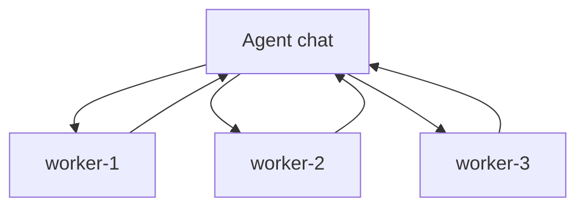

# 05 — Workers and multi-agent

Back to [vault index](README.md).

`src/main/agents.ts` is the durable broker for **the configured agent's worker garden**. The persisted
broker owner role is still named `prime` internally for compatibility; it is not a second persona
above Eve, Eva, or whatever name `mcp.connectorName` gives this installation's agent.

## Topology



Workers cannot message other workers. The installation's agent can steer her workers, and workers
report their results back to her.

Friendly ids like `worker-2` are local to one run and are never global ownership keys.

## Worker Plans and Eve activity

An assigned worker with several meaningful steps should create **its own real `update_plan`**
near the start and keep it updated with the implementation and checks actually performed. A
Markdown checklist or a Prime-authored overview is not that worker's Plan. The broker does
**not** synthesize checklists from historical worker tool calls. A worker session that never
wrote a Plan but delivered finish reports gets one archived Eve activity → Done entry labelled
"Recovered from finish reports (no Plan was written)", built only from those delivered reports.
A worker with neither a Plan nor a delivered report has no card; that is a coverage limit, not
evidence that the worker did nothing.

`src/main/mcp/plan-tool.ts` writes the worker's plan into its exact local session, then
`src/main/plans.ts` projects an accepted revision into the first-class Plans catalog. Audience
comes from **durable source-session provenance**: a worker/helper `origin.kind`, or that
origin reached through the `resume.fromSessionId` chain, is shown under **Eve activity**;
ordinary Prime/user Plans remain in the human-facing Plans view. The manager can also show
worker work in a collapsed **Verified work** summary. Only Plans with durable origin evidence
are attributed this way; a worker-friendly label is not ownership proof.

A completed worker checklist is **Ready to archive** from its substantive work items. Reporting
or handing off to Prime is a lifecycle result, not a fourth checkbox or an archive blocker;
legacy report-only trailing steps do not keep an otherwise completed worker Plan artificially
Live. `agents action=finish` submits the worker result separately, and delivered-report evidence
is tracked by message id and session ancestry. Eligible completed worker Plans can **auto-archive
when that exact report delivery is proved**, only while **Allow Eve to archive completed Eve work**
is on, and then remain visible in Eve activity → Done. A heartbeat review worker's own finished
Plan is archived with its review receipt under the same permission. A
completed ordinary human Plan instead stays Live until its user archives it. Do not equate
"all checklist items done", "reported", "archive accepted" or "worker sleeping".

See [Plans and provenance](06-pins-quilts-and-plans.md) and
[debugging a missing worker Plan](11-debugging-playbooks.md).

## The configured agent is the human-facing owner

The worker broker is the persistent harness. The model/runtime used for the owning agent and the
model/runtime used for workers are selectable execution backends. They do not create another identity
above the configured agent name.

Conceptually:

```text
                  ParadigmEve
             orchestration + durability
                       |
              +--------+--------+
              |                 |
          Agent owner         Workers
              |                 |
        selected backend   selected backend
```

This separation is why a future configuration can mix a managed orchestrator with local or cheaper
workers without rebuilding the broker around a new identity model. Selection never means fallback:
an unavailable or unimplemented backend is a visible user/setup boundary.

In the current source line, GPT Chat is the end-to-end agent executor for the owning agent (Prime).
Since 2.3.5, Ollama is a supported **worker** driver: Settings > Agent execution takes an
OpenAI-compatible endpoint (HTTP only on loopback, HTTPS elsewhere) and an exact model id such as
`gemma4:cloud`. Spawned Ollama workers never open a ChatGPT tab; the app runs a bounded model/tool
loop with a broker-issued run/worker principal and the same live Core permissions. Each Ollama
worker is one-shot: it finishes (or fails) as a terminal row, cannot be revived, and a restart
fails any in-flight Ollama worker visibly instead of reconstructing its transcript. Ollama cannot
be the agent driver. GPT Work and custom remain unavailable agent executors.

The desktop chat can also send a single turn to Ollama (2.3.5). The chat owns its history, not the
provider: every turn, whichever provider answered, lands in the same session archive with a
`provider` tag on Ollama messages. Ollama turns read the whole archive; a ChatGPT turn after Ollama
turns receives a catch-up of exactly the turns it did not see. A switch that exposes earlier turns
to a different provider needs the user's confirmation, and a chat marked Local only refuses ChatGPT
and Ollama Cloud (`:cloud` models or HTTPS endpoints). If you are asked about an earlier part of a
chat that another model answered, read the session history rather than assuming you never saw it. `/models` or
`/chat/completions` reachability alone is never agent-execution readiness proof.

## Run and worker identities

One conversation belonging to the installation's agent owns a worker garden. An active broker run has
a fresh run/incarnation UUID. Browser command/revival transactions carry that exact run identity so a
`worker-1` from another run cannot be confused with this one.

## Worker states

Conceptually:

```text
invited -> active -> sleeping
           |  \-> detached
           |       \-> sleeping/failed
           \-> finished/failed

sleeping --agent message--> waking -> active
```

Important distinctions:

- **sleeping** = reusable and does not consume an active slot;
- **finished/failed** = terminal worker history;
- **detached** = browser tab disappeared, but the server-side turn may still exist, so the slot remains occupied;
- **waking** = revival is in progress and owns a slot.

By default config starts with 2 workers; settings allow up to 8. The product/tool surface can support more concurrent workers when configured, but availability is also constrained by ChatGPT/model/rate-limit behavior.

## Spawn

Spawn follows the durability rule:

1. The owning agent conversation is identified from exact caller conversation evidence.
2. A slot is reserved and worker state is persisted.
3. Browser command opens the fresh worker chat and types the task.
4. The worker's first exact tool activity binds its real conversation identity.

If browser delivery is ambiguous, the broker does not invent a new worker and duplicate the task.

## Messaging is at-least-once with ACK on later call

Agent/worker messages are offered on tool results. A message is acknowledged only when the recipient
later makes an authenticated call proving it received the prior offer.

This means callers should make their handling idempotent: a repeated report can be the same durable offer, not a new instruction.

## Finish means sleep by default

`agents action=finish` publishes a structured worker result and normally transitions that worker to **sleeping**, preserving its exact ChatGPT conversation/context for later reuse.

If context has crossed the configured hard reuse ceiling, the worker cannot safely be revived and becomes terminal instead.

## Revival

When the agent messages a sleeping worker:

1. broker reserves a slot and marks it waking;
2. the exact retained worker conversation is targeted;
3. browser revival command is durably claimed/redeemed;
4. ChatGPT accepts the new message;
5. the worker becomes active only when first-hand liveness arrives (new turn/tool activity), not merely from browser ACK.

Two consecutive failed wake attempts are reported instead of retrying forever.

## App-owned heartbeat review worker

The 22-minute semantic heartbeat uses a special **bounded review-only worker**, managed by the
same broker but tied to one exact Prime lineage and debt key. It must record its own review
checklist via `update_plan`, which appears in Eve activity. It may read the exact locally recorded
session/selected-Plan sources, call `chat_review_plan` and `chat_review_complete` with the current
key, and report an actionable finding to Prime. It may **not** inspect ChatGPT browser history,
execute or delegate user work, mutate user Plans, open the browser, install, send user messages or
claim another worker's work. The MCP kernel also enforces this restricted tool lane; Prime owns
decisions and any later execution.

`dispatchHeartbeatReviewWorker` persists the review identity before reviving/spawning. Active
workers that have gone silent are not assumed to be executing forever: the broker has bounded
stale-worker recovery and backoff so an unreceipted epoch does not repeatedly wake/report each
minute. A worker's chat finishing without the exact heartbeat receipt leaves the review debt
pending. See [heartbeat semantics](02-runtime-browser-recovery.md).

The app names this chat **Heartbeat review** with a **Heartbeat** label, recognised from the task
text the app itself wrote (`isHeartbeatReviewOrigin`). ChatGPT's own title for it comes from the
connector's coding-agent instructions and wrongly suggests a chat that can edit and run things.

## Dormant families

Closing the owner's chat tab does not automatically destroy reusable workers. A garden with sleeping
history or pending reports can be parked as dormant and reactivated when exact owner or worker
activity returns.

This is why **Clear swarm** and “disable multi-agent” have different meanings:

- disabling multi-agent parks/canonicalizes reusable history so re-enabling can recover it;
- Clear swarm intentionally destroys the history.

## Compact & Resume with workers

Owner transfer is not a separate heuristic. `session/continuation.ts` freezes the broker's internal
`prime` binding during preflight and commits the new owner conversation only after the session's
durable A -> B rebind succeeds.

That preserves one authority: the continuation transaction.

The worker Plan's source follows its **session provenance** through any subsequent continuation;
do not reclassify it as a user Plan because its current ChatGPT conversation changed.

## Workspace inheritance

Workers can inherit the owning agent chat's learned project cwd during spawn, but temporary worker
keys include the exact run id. Once the worker's exact conversation is proven, the cwd is parked onto
`chat:<conversation-id>`.

No friendly worker name can select another worker's cwd.

---

> **Implementation contracts.** The sections below moved here unchanged from the former single-file
> `AGENTS.md` map. Their § numbers are kept so references such as “§14” still resolve; the
> [Vault index](README.md#former-agentsmd-sections) lists where each section lives.

## 16. Multiple prime families and reusable workers

**Intent:** each prime can delegate bounded work to its own reusable workers while several
independent user tasks run at once. Inside a family the topology is a star: workers report to
their prime and cannot create worker descendants.

`agents.ts` is the one broker. Its run map and v6 `activeRuns` snapshot hold independent families;
`maxWorkers` applies **per family**, not to one global active run. Display names such as
`worker-1` are scoped by run incarnation/prime. Resolve a proven caller first, then its family;
never select the newest run globally. Workspace, inbox, activity and finish routing follow
that identity. Old single-active-run documentation is obsolete.

Worker model and reasoning belong to the user's saved app settings by default. Model-visible
instructions and the agents schema require omitting each override unless the user explicitly
requests it; do not ask for those settings merely to spawn. `agents.ts` resolves omitted fields
from current config at admission, so the executor need not know or repeat their concrete values.

Spawn validates capacity, objective/context, account-observed model/effort, workspace and role,
then durably reserves the worker before handing out browser work. Model checks precede every
batch mutation; unknown ids fail with observed choices. With no retained catalog, native
selection still must confirm the exact request. Shared context carries common project/instructions;
each worker gets its bounded assignment. Invitations, active workers,
detached workers and waking workers retain their reservation; sleeping workers do not occupy
an active slot. User/prime cancellation retires the exact incarnation, not a reused slot name.

`finish` normally stores a report and **sleeps** the worker for follow-up. Reuse a suitable
sleeping worker with `agents action=message` before spawning a replacement. Messaging, inbox
delivery and report receipts are at-least-once transports with durable message identities;
acknowledgement belongs to the exact recipient/run, not a UI read. Pending reports remain
available when the last worker sleeps and the family parks.

Worker completion is driven by **canonical final-response evidence**, not sidebar decoration. The
Companion reads ChatGPT's own message model and promotes only the current answer-eligible assistant
message whose provider state is a successful terminal end into `assistant_message(final:true)`;
that stable final is the worker-stop/review trigger. Streaming prose, tool rows, quiet periods,
"Thinking", and sidebar blue dots are not completion. `turn_end` corroborates lifecycle state but
may arrive in a different journal batch or be lost across a reload, so the stable final remains the
terminal fact. Prefer exact run/incarnation, conversation, turn/message and local-session identity
throughout; never infer ownership from a title, dot or visual recency.

After that final crosses the worker/broker durability boundary, the worker normally becomes
**sleeping** and releases its slot while retaining its exact conversation, transcript, workspace and
ability to receive more work. ParadigmEve may proactively queue one coalesced Prime review turn with
the parsed worker result. Prime compares that report with the original assignment, repository state,
claimed verification, overlapping edits and remaining priorities. Computer Use is optional visual
inspection/fallback, not the completion detector and not a prerequisite for reuse. A title containing
"Complete" is not merge or acceptance evidence.

If review exposes a bounded useful next step -- incomplete scope, a real bug, missing required
verification, or an actionable High/Medium finding -- prefer `agents action=message` to that same
sleeping worker. That message must revive/open the exact retained worker conversation and make the
worker writable again; a sleeping worker is a paused collaborator, never a read-only archive. If a
manual browser intervention is deliberately used instead, write into the exact worker conversation,
**press Enter to send it**, and confirm submission; text left in a composer is not delivery. If no
follow-up is useful, leave the worker sleeping and do not spawn a duplicate just to create activity.
Aggregate coordination in one Prime conversation. Use a native/phone notification only through an
actually supported delivery mechanism and never claim phone notification success from a desktop-only
Electron notification or an inferred channel. Broker ownership and exact lifecycle state take
precedence over sidebar dots, recent activity and historical labels.

After a worker reaches its own 400k estimated-context ceiling, its next stop becomes terminal
and it is no longer reusable. Do not interrupt its current useful work merely for that ceiling.
Status/message remeasure sleepers before revival. A terminal worker can be replaced deliberately;
raising the user's worker cap is not a substitute for lifecycle correctness.

Detached means browser attachment is missing, not necessarily that tool execution died. An
exact call can prove the worker server-side alive; a new page can reattach it. During waking,
an already-alive proof may cancel an unclaimed reopen, but after handout the existing operation
owns delivery. A new accepted call/turn proves post-delivery activation. A replayed old final
must not put the revived worker back to sleep.

Broker mutations stage and durably publish the exact run object; async rollback must not
restore another family's state. Disable parks families; Clear deliberately discards the
broker's retained history/fences. Dormant families are bounded (16 / seven days). Retirement
and browser close are separate: a sleeping worker becomes eligible for page reuse after two
quiet minutes and page closure after five (§14), while remaining available for revival by its
exact conversation id. Compact & Resume rebinds a prime within its
family; it does not merge families or move a terminal process to another principal.

`move_eve_here` (`src/main/eve-handover.ts`) is the explicit-user-request counterpart for a Prime
whose chat is deleted or usage-locked and so cannot take part in Compact & Resume. Called from the
destination chat, it moves the durable agent identity and, through `movePrimeOnUserRequest`, the
whole worker family (workers, histories, queue) to that exact conversation, saves both before it
reports success, and rolls both back on failure. It needs no approval from the old chat. It refuses
workers/helpers, blocked or superseded chats, a chat that already leads another family, and an old
Prime with an open turn updated in the last five minutes. It never closes or reloads any tab.

The optional `native_delegation` research ledger is **not** another worker backend or a hosted
child-launch API. Only an exact Prime conversation/session can prepare up to four bounded
read-only assignments after user opt-in; preparation records intent, not a started child.
Prime-reported findings and unresolved cancellation survive restart without invented child
identity, receipt, billing or successful termination. While a record remains active or unknown,
`mcp/kernel.ts` refuses effectful Eve tools for the entire parent conversation, including
stale/missing session joins; unknown caller identity is denied if any such record is active.
A hosted child shares the parent's exact proof and may itself call `close`, so a `closed` or
`unsupported` settlement made inside a turn records that turn (`closedInTurn`) and keeps the lock
until the owner session has left it; the kernel learns this from the session before its check.
The lock is read from both the saved and the being-written ledger, so a close unlocks only once
durable. The 1,000-record bound is on retained records: the oldest settled, unheld ones give way.
The record retains its original run ID as provenance, while exact conversation + durable session
authorize recovery if a run parks or changes across restart. Even this guard cannot restrict
non-Eve host connectors or revoke effects already in flight. Visible browser-backed ChatGPT
workers remain the default, and Chat/Work/model/reasoning changes remain human choices.

The app's configurable worker capacity is distinct from the coding agent's delegation policy
in §19. Do not infer permission to launch development subagents from a product feature toggle.
Agent execution selection is also distinct from capacity: `shared/agent-backends.ts` owns the
build-flavor driver matrix, while spawn/readiness recheck whether the selected driver has a real
executor. An excluded or unimplemented selection is a user boundary and must never silently fall
back to another driver. See §20 for the build flavors and exact included-driver sets.
